# Xử lý Duplicate và Out-of-Order CDC Events trong ClickHouse: Đừng phó mặc cho ReplacingMergeTree!

"Tại sao đơn hàng vừa đổi trạng thái sang COMPLETED ở PostgreSQL, mà SELECT trên ClickHouse lại thấy... cả 2 dòng PENDING và COMPLETED?"

Nếu bạn từng xây dựng pipeline streaming CDC từ PostgreSQL vào ClickHouse để làm Real-time Dashboard, chắc chắn bạn đã từng gặp cảnh tượng này ít nhất một lần lúc 2 giờ sáng.

Nhiều anh em vội vàng thêm từ khóa `FINAL` vào câu truy vấn. Nhưng cái giá phải trả là CPU spike lên 90% và latency tăng gấp 4 lần khi bảng chạm mốc vài chục triệu dòng.

Vậy bản chất vấn đề nằm ở đâu và giải pháp sản xuất (Production-grade) là gì?

---

### 1. Bản chất của ReplacingMergeTree: Sự thật về Background Merge

Rất nhiều kỹ sư nhầm tưởng `ReplacingMergeTree` hoạt động như `UPSERT` hoặc `ON CONFLICT DO UPDATE` trong RDBMS truyền thống.

Thực tế hoàn toàn không phải vậy:
- Khi dữ liệu được ingest vào ClickHouse, nó được ghi thành các data parts bất biến (immutable parts).
- `ReplacingMergeTree` CHỈ thực hiện khử trùng lặp (deduplicate) trong quá trình **background merge** giữa các data parts.
- Thời điểm background merge diễn ra là hoàn toàn bất đồng bộ (asynchronous) và ClickHouse tự quyết định dựa trên thuật toán nén.

Hậu quả: Trước khi merge diễn ra, các dòng duplicate vẫn tồn tại song song trong bộ nhớ storage.

---

### 2. Tại sao lạm dụng `SELECT ... FINAL` lại là "bẫy hiệu năng"?

Khi thêm `FINAL`, ClickHouse bị ép phải merge các parts ngay tại thời điểm thực thi câu lệnh truy vấn (query-time merge).

Dù các phiên bản ClickHouse gần đây đã hỗ trợ parallel final, nhưng trên các bảng lớn:
- Tốn tài nguyên RAM và CPU để ghép nối các part trên ổ đĩa.
- Làm mất đi lợi thế scan cột siêu tốc đặc trưng của Columnar Engine.
- Phá vỡ SLA của các hệ thống Real-time BI Dashboard với hàng trăm user truy vấn đồng thời.

---

### 3. Giải pháp Production: Bộ đôi `Version Column` + `argMax()`

Thay vì ép ClickHouse dọn dẹp vật lý ở tầng storage bằng `FINAL`, chúng ta xử lý logic ở tầng truy vấn phân tán với hàm tổng hợp `argMax()`.

Kiến trúc thực hiện như sau:
1. **CDC Ingestion**: Dùng Debezium bắt WAL log từ PostgreSQL, trích xuất `lsn` hoặc timestamp `ts_ms` làm trường `_version` (UInt64).
2. **ClickHouse Table**: Khởi tạo bảng với `ENGINE = ReplacingMergeTree(version)`.
3. **Query Pattern**:
```sql
SELECT
    order_id,
    argMax(status, version) AS current_status,
    argMax(total_amount, version) AS current_amount,
    argMax(updated_at, version) AS last_updated
FROM default.orders_target
WHERE order_date >= today() - 7
GROUP BY order_id;
```

**Tại sao cách này vượt trội?**
- ClickHouse tận dụng tối đa Vectorized Execution để tính toán `argMax()` trên từng block bộ nhớ cực kỳ nhanh.
- Không phát sinh I/O ép merge parts trên đĩa.
- Luôn đảm bảo kết quả chính xác 100% theo trạng thái mới nhất của event, bất kể background merge đã chạy hay chưa.

---

### 4. Kinh nghiệm thực chiến rút ra

- **Partitioning hợp lý**: Luôn partition theo ngày/tháng (`toYYYYMM(order_date)`). Background merge không bao giờ gom dòng giữa 2 partition khác nhau.
- **Idempotency ở tầng Consumer**: Nếu dùng Kafka Engine kết hợp Materialized View, hãy tune `max_insert_block_size` (khuyến nghị 65,536 đến 100,000 rows) để tránh tạo ra quá nhiều "small parts" khiến ClickHouse quá tải merge tree.

---

---

### 📊 Sơ đồ Kiến trúc: Luồng CDC từ PostgreSQL qua Kafka vào ClickHouse

```mermaid
flowchart LR
    subgraph SourceLayer["1. Source Transactional Layer"]
        PG["PostgreSQL OLTP"] -->|"WAL Logs"| DEB["Debezium Connector"]
    end

    subgraph StreamingLayer["2. Event Streaming"]
        DEB -->|"JSON / Avro Events + LSN"| KAFKA["Apache Kafka Topic\n(orders_cdc)"]
    end

    subgraph ClickHouseIngest["3. Ingestion Engine"]
        KAFKA -->|"Batch Consume"| CH_KAFKA["ClickHouse Kafka Engine"]
        CH_KAFKA -->|"Trigger Stream"| MV["Materialized View"]
    end

    subgraph StorageLayer["4. Storage & Storage Parts"]
        MV -->|"Append Immutable Parts"| TARGET["ReplacingMergeTree\n(orders_target)"]
        TARGET -.->|"Asynchronous Background Merge"| MERGED["Compacted Parts\n(Deduplicated eventually)"]
    end

    subgraph ServingLayer["5. Query & Analytics"]
        TARGET -->|"Vectorized Aggregation\nargMax(col, version)"| QUERY["Immediate Consistency Query"]
        QUERY --> BI["Real-time Dashboard & BI"]
    end

    classDef source fill:#e0f2fe,stroke:#0284c7,stroke-width:2px;
    classDef stream fill:#fef3c7,stroke:#d97706,stroke-width:2px;
    classDef ingest fill:#f3e8ff,stroke:#9333ea,stroke-width:2px;
    classDef storage fill:#dcfce7,stroke:#16a34a,stroke-width:2px;
    classDef query fill:#fee2e2,stroke:#dc2626,stroke-width:2px;

    class PG,DEB source;
    class KAFKA stream;
    class CH_KAFKA,MV ingest;
    class TARGET,MERGED storage;
    class QUERY,BI query;
```



---

Hệ thống Data Platform ở công ty bạn đang giải quyết bài toán CDC deduplication bằng cách nào? Bạn đang dùng `FINAL`, `argMax()`, hay chuyển hẳn sang `CollapsingMergeTree`?

Cùng chia sẻ kinh nghiệm thực tế ở phần bình luận nhé! 👇

#DataEngineering #ClickHouse #PostgreSQL #ApacheKafka #RealTimeAnalytics #DatabaseArchitecture #CDC
