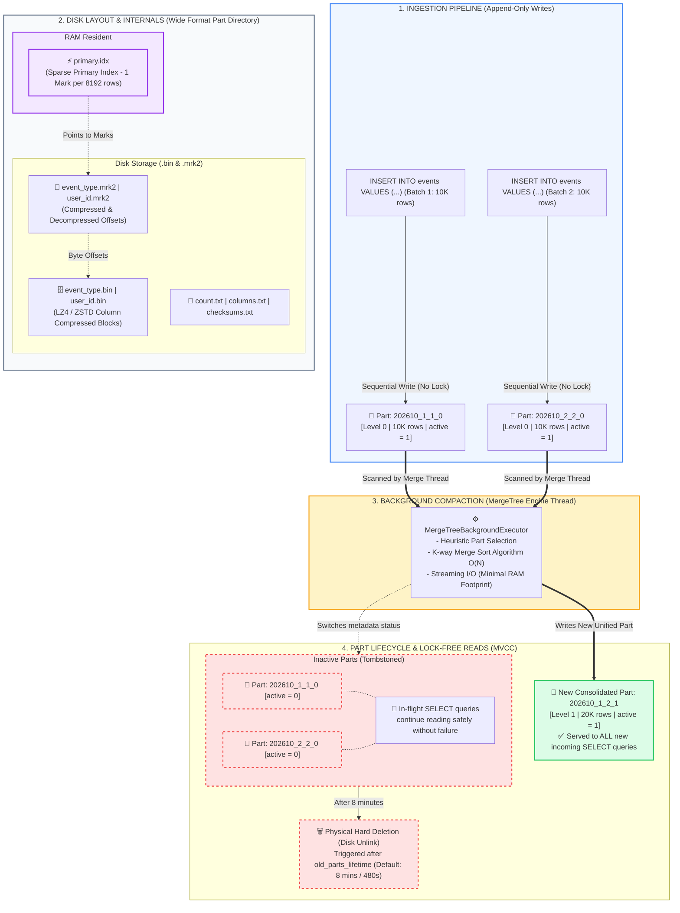

# MergeTree Engine: Trái tim của ClickHouse hoạt động thế nào? (Cơ chế Immutable Parts, LSM-tree inspired, và quá trình Background Compaction)

"Tại sao tôi chỉ chạy vài lệnh INSERT mà kiểm tra thư mục dữ liệu trên đĩa lại thấy hàng chục thư mục con với những cái tên kỳ lạ như `202610_1_1_0`, `202610_2_2_0`? Tại sao ClickHouse nuốt được hàng triệu dòng mỗi giây mà không hề bị khóa bảng (lock table)? Và tại sao vừa thử chạy lệnh `OPTIMIZE TABLE ... FINAL` thì CPU và Disk I/O của server nhảy vọt lên 100%?"

Nếu coi ClickHouse là một siêu xe thể thao trong làng phân tích dữ liệu (OLAP), thì họ bảng **MergeTree** chính là khối động cơ V12 tạo nên sức mạnh đó. 

Hầu hết kỹ sư chuyển từ MySQL hay PostgreSQL sang ClickHouse đều ngỡ ngàng khi nhận ra: **MergeTree không hề hoạt động giống bất kỳ CSDL quan hệ truyền thống nào.**

Để làm chủ ClickHouse trong môi trường production, bạn bắt buộc phải hiểu cơ chế nội tại sâu nhất của nó: **Triết lý Bất biến (Immutable Data Parts)**, **Cấu trúc lưu trữ vật lý trên đĩa**, và **Cơ chế Background Compaction**.

---

### 1. Triết lý "Bất biến" (Immutable Parts): Cảm hứng từ LSM-Tree

Trong các CSDL quan hệ truyền thống (RDBMS), dữ liệu được ghi vào các khối trang (Page 8KB/16KB) ngẫu nhiên. Khi bạn sửa hay thêm dữ liệu, CSDL thực hiện **In-place Update** (ghi đè ngay trên trang cũ), liên tục khóa trang (page locks), tách trang (page splits) và ghi nhật ký WAL. Cách làm này tối ưu cho giao dịch đơn lẻ (OLTP), nhưng là "án tử" cho tốc độ ghi hàng triệu dòng/giây.

ClickHouse tiếp cận theo hướng hoàn toàn khác, lấy cảm hứng từ cấu trúc **LSM-tree (Log-Structured Merge-tree)**:
- **Append-only & Sequential I/O**: Dữ liệu chỉ được ghi nối tiếp. Khi câu lệnh `INSERT` được thực thi, ClickHouse sắp xếp dữ liệu trong RAM theo `ORDER BY` rồi ghi thẳng xuống đĩa thành một thư mục độc lập gọi là **Data Part**.
- **Immutable (Tính bất biến)**: Một khi Data Part đã ghi xuống đĩa, nó **không bao giờ bị sửa đổi**. Không có chuyện in-place update, không có row-level lock, không có tranh chấp tài nguyên giữa luồng đọc và luồng ghi.
- **Background Compaction**: Để tránh việc sinh ra hàng ngàn file nhỏ làm nghẽn hệ thống tệp của OS, ClickHouse chạy một luồng ngầm liên tục gộp (merge) các parts nhỏ thành các parts lớn hơn.

---

### 2. "Phẫu thuật" Cấu trúc một Data Part trên Đĩa

Hãy vào thư mục `/var/lib/clickhouse/data/<database>/<table>/` trên server. Bạn sẽ thấy các thư mục có cấu trúc tên dạng:
```
202610_1_1_0
```

#### Quy ước đặt tên Part (Part Naming Convention):
Cú pháp: `<partition_id>_<min_block>_<max_block>_<level>`
- `202610`: **Partition ID** (tương ứng với tháng 10/2026 nếu bạn đặt `PARTITION BY toYYYYMM(event_time)`).
- `1`: **Min Block Number** — Số thứ tự khối đầu tiên trong part.
- `1`: **Max Block Number** — Số thứ tự khối cuối cùng. Với part mới insert, Min luôn bằng Max.
- `0`: **Merge Level** (Độ sâu gộp) — Part mới ghi trực tiếp có level = 0. Khi gộp hai part level 0, part mới sẽ có level = 1. Khi gộp hai part level $N_1$ và $N_2$, part mới có level = $\max(N_1, N_2) + 1$.

#### Bên trong thư mục Part (Định dạng Wide tiêu chuẩn):
```
├── primary.idx                  <- Sparse Primary Index (nằm 100% trong RAM)
├── user_id.bin                  <- Cột user_id (Dữ liệu nén LZ4/ZSTD)
├── user_id.mrk2                 <- Con trỏ Mark ánh xạ offset nén & giải nén
├── event_type.bin               <- Cột event_type
├── event_type.mrk2              <- Con trỏ Mark của event_type
├── count.txt                    <- Tổng số dòng chính xác trong part
├── columns.txt                  <- Danh sách tên cột và kiểu dữ liệu
├── default_compression_codec.txt<- Thuật toán nén mặc định (CODEC(LZ4))
└── checksums.txt                <- Checksum SHA256/XXH64 kiểm tra toàn vẹn
```

**Sợi dây liên kết ma thuật giữa Index và Dữ liệu:**
1. Cứ mỗi **8192 dòng** (gọi là 1 granule), ClickHouse ghi 1 giá trị index vào `primary.idx`. Tệp này cực kỳ nhẹ (vài chục MB cho hàng tỷ dòng) nên được **nạp trọn vẹn vào RAM**.
2. Khi query tìm kiếm, ClickHouse quét trong RAM trên `primary.idx` để xác định các granule thỏa mãn điều kiện.
3. Từ số thứ tự granule, ClickHouse đọc tệp `.mrk2` để lấy đúng 2 giá trị offset: *vị trí block nén trong tệp `.bin`* và *vị trí dòng sau khi giải nén*.
4. ClickHouse chỉ nạp và giải nén đúng block đó. Không cần quét toàn bộ file!

---

### 3. Vòng đời Data Parts: Từ lúc sinh ra đến Background Compaction

Toàn bộ sức mạnh ổn định của MergeTree nằm ở vòng đời linh hoạt này:

#### Bước 1: Ingestion (Sinh ra Part Level 0)
- Giả sử bạn gửi Batch 1 (10K dòng) -> ClickHouse tạo part `202610_1_1_0` (`active = 1`).
- Bạn gửi tiếp Batch 2 (10K dòng) -> ClickHouse tạo part `202610_2_2_0` (`active = 1`).
- Cả 2 part đều sẵn sàng phục vụ các câu truy vấn `SELECT` ngay lập tức.

#### Bước 2: Background Merge Thread (K-way Merge Sort)
- Luồng nền `MergeTreeBackgroundExecutor` định kỳ chọn các parts nhỏ trong cùng partition có kích thước tương đương để gộp.
- Vì mỗi part trên đĩa đã được sắp xếp sẵn theo `ORDER BY`, quá trình gộp thực chất là thuật toán **K-way Merge Sort**.
- Đây là thuật toán đọc tuần tự (stream) với độ phức tạp tuyến tính $O(N)$, tốn cực kỳ ít RAM.
- ClickHouse ghi ra một part mới hoàn toàn: `202610_1_2_1` (Level 1, chứa 20K dòng).

#### Bước 3: Trạng thái Active vs Inactive (MVCC không khóa)
- Ngay khi part mới `202610_1_2_1` ghi xong và khớp checksum:
  - Part mới lập tức được kích hoạt: **`active = 1`**. Mọi truy vấn mới bắt đầu từ thời điểm này sẽ đọc part mới.
  - Hai part gốc `202610_1_1_0` và `202610_2_2_0` bị đánh dấu: **`active = 0`** (Inactive / Tombstoned).
- **Điều gì xảy ra với các câu truy vấn SELECT đang chạy dở?**
  - Chúng vẫn tiếp tục đọc từ 2 part cũ (`active = 0`) một cách an toàn mà không hề hay biết đã có part mới. Không bị lock, không bị crash, không trả về dữ liệu rác!

#### Bước 4: Dọn dẹp Tombstone (Hard Deletion)
- ClickHouse không xóa part cũ ngay lập tức. Tham số `old_parts_lifetime` (mặc định là **8 phút / 480 giây**) tạo ra một vùng đệm an toàn.
- Sau 8 phút, khi chắc chắn không còn câu truy vấn nào tham chiếu đến, ClickHouse mới xóa vật lý thư mục đó khỏi đĩa.

---

### 4. Hands-on SQL: Giám sát Parts và Compaction trong Production

Đừng bao giờ "mù mờ" về trạng thái lưu trữ của cụm ClickHouse. Hai bảng hệ thống bạn phải thuộc lòng:

#### 1. Kiểm tra trạng thái và kích thước Data Parts:
```sql
SELECT
    partition,
    name,
    active,
    level,
    rows,
    formatReadableSize(bytes_on_disk) AS disk_size,
    modification_time
FROM system.parts
WHERE table = 'events'
ORDER BY modification_time DESC
LIMIT 10;
```

#### 2. Soi luồng Background Compaction đang chạy thời gian thực:
```sql
SELECT
    table,
    elapsed,
    round(progress * 100, 2) AS pct_done,
    formatReadableSize(bytes_read_uncompressed) AS read_uncompressed,
    formatReadableSize(bytes_written_uncompressed) AS written_uncompressed,
    columns_written,
    memory_usage
FROM system.merges;
```

---

### 5. Góc nhìn thực chiến: Cái bẫy `OPTIMIZE TABLE ... FINAL`

Nhiều kỹ sư mới thường có thói quen: *"Tôi vừa insert xong, tôi muốn dữ liệu phải gộp ngay thành 1 part duy nhất cho gọn gàng"* và tiện tay gõ:
```sql
OPTIMIZE TABLE events FINAL; -- ⚠️ CẢNH BÁO NGUY HIỂM!
```

**Tại sao đây là một Anti-Pattern nguy hiểm trong Production?**
1. **Bão Disk I/O & Bão CPU**: Khi bạn gọi `FINAL`, ClickHouse buộc phải đọc toàn bộ dữ liệu của phân vùng (có thể là hàng trăm GB hoặc cả tỷ dòng), giải nén, sắp xếp gộp lại và ghi ra đĩa mới. Toàn bộ tài nguyên máy chủ sẽ bị vắt kiệt, khiến latency của các câu query khác tăng đột biến.
2. **Kích hoạt lỗi kinh hoàng: "Too many parts (300+) in all data parts in table"**: Luồng merge bị quá tải vì phải gánh các tác vụ `FINAL` cưỡng bức, không kịp xử lý các part mới sinh ra từ luồng streaming. Khi số lượng part vượt ngưỡng an toàn (thường là 300 parts), ClickHouse sẽ **từ chối nhận lệnh INSERT** để tự bảo vệ.

**Nguyên tắc vàng**: Hãy để `MergeTreeBackgroundExecutor` tự động làm việc theo đúng lịch trình heuristic của nó. Chỉ dùng `OPTIMIZE ... FINAL` trong môi trường Dev/Test hoặc trong các batch job bảo trì đặc biệt vào ban đêm cho bảng `ReplacingMergeTree`.

---

### 🎯 Takeaway cốt tử cho Data Engineers:
1. **Batching là mệnh lệnh sống còn**: Không bao giờ insert từng dòng đơn lẻ (single-row insert) vào ClickHouse. Mỗi batch nên có tối thiểu từ **1,000 đến 100,000 dòng** (hoặc dùng tính năng `async_insert = 1` của ClickHouse).
2. **Dữ liệu trên đĩa là bất biến**: Hiểu rõ cơ chế `active = 1` và `active = 0` giúp bạn tự tin vận hành mà không sợ xung đột lock giữa đọc và ghi.
3. **Sparse Index nằm trong RAM**: `primary.idx` kết hợp tệp `.mrk2` chính là "bản đồ chỉ đường" giúp ClickHouse đọc trúng đích từng granule mà không cần scan lãng phí.

---

### 📊 Sơ đồ Kiến trúc: Vòng đời Data Parts & Quá trình Background Merge trong MergeTree



---

Trong hệ thống ClickHouse của team bạn, số lượng parts trung bình trên mỗi bảng đang là bao nhiêu? Bạn đã từng gặp sự cố với `Too many parts` hay chưa? Hãy cùng bàn luận bên dưới nhé! 👇

#DataEngineering #ClickHouse #MergeTree #BigData #DatabaseInternals #LSMTree #Compaction #HighThroughput #Analytics #DatabaseArchitecture
