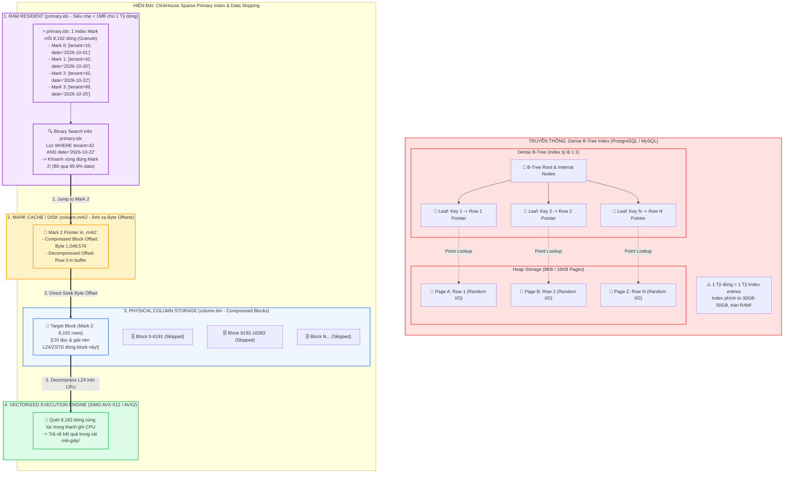

# Primary Key vs ORDER BY trong ClickHouse: Sai lầm phổ biến của dân RDBMS (Giải bài toán Sparse Primary Index, Index Granularity 8192 & Data Skipping)

"Tạo bảng trong ClickHouse, bạn đặt `PRIMARY KEY (id)` và đinh ninh rằng nó sẽ đảm bảo dữ liệu không bị trùng lặp, đồng thời tạo ra một cây B-Tree giúp tìm kiếm tức thì? 

Hãy cẩn thận: Bạn vừa bước chân vào cái bẫy kinh điển nhất của hầu hết kỹ sư khi chuyển từ thế giới RDBMS (PostgreSQL, MySQL, Oracle) sang ClickHouse!"

Trong hệ quản trị CSDL quan hệ truyền thống, `PRIMARY KEY` là một khái niệm bất di bất dịch: Nó vừa áp đặt **ràng buộc duy nhất (UNIQUE constraint)**, vừa tự động xây dựng một cây **Dense B-Tree Index** trỏ chính xác đến từng dòng dữ liệu trên đĩa.

Nhưng trong ClickHouse – một CSDL phân tích dạng cột (Columnar OLAP) sinh ra để nuốt hàng tỷ dòng dữ liệu – mọi quy tắc quen thuộc trên đều bị phá vỡ hoàn toàn:
1. `PRIMARY KEY` **KHÔNG hề đảm bảo tính duy nhất**. Bạn có thể chèn hàng triệu dòng trùng khóa chính mà bảng vẫn tiếp nhận bình thường.
2. ClickHouse **KHÔNG dùng B-Tree Index**. Thay vào đó là cơ chế **Sparse Primary Index (Chỉ mục thưa thớt)** với tỷ lệ 1:8192.
3. `PRIMARY KEY` và `ORDER BY` là hai khái niệm độc lập dù có mối quan hệ hữu cơ mật thiết.

Tại sao ClickHouse lại lựa chọn triết lý kỳ lạ này? Làm thế nào một chỉ mục chỉ nặng chưa đầy **1 Megabyte** lại có thể điều hướng mượt mà trên bảng **1 tỷ bản ghi**? Hãy cùng mổ xẻ chi tiết!

---

### 1. Cái bẫy số 1: "Tại sao có PRIMARY KEY mà dữ liệu vẫn bị Duplicate?"

Trong MySQL InnoDB hay PostgreSQL, khi bạn insert một dòng có `id = 1` đã tồn tại, hệ thống lập tức ném lỗi:
`ERROR 1062: Duplicate entry '1' for key 'PRIMARY'`.

Nhưng trong ClickHouse:
```sql
CREATE TABLE users_bad (
    id UInt64,
    name String,
    created_at DateTime
) ENGINE = MergeTree()
PRIMARY KEY (id)
ORDER BY (id);

-- Chèn 2 dòng trùng id
INSERT INTO users_bad VALUES (1, 'Alice', now());
INSERT INTO users_bad VALUES (1, 'Alice V2', now());

-- Kiểm tra: Cả 2 dòng đều tồn tại song song!
SELECT count() FROM users_bad WHERE id = 1; -- Kết quả: 2
```

**Bản chất:** ClickHouse là một hệ thống phân tích dữ liệu quy mô lớn (OLAP), hoạt động theo mô hình ghi nối tiếp bất biến (Append-only). Nếu mỗi lần ghi (Insert) dữ liệu với tốc độ 500,000 dòng/giây, ClickHouse phải khóa bảng để quét kiểm tra tính duy nhất (Unique check) trên toàn bộ hàng tỷ dòng cũ, thì thông lượng ghi sẽ tụt dốc thảm hại.

👉 **Quy tắc cốt tử:** Muốn xử lý dữ liệu trùng lặp trong ClickHouse, bạn không dùng ràng buộc PRIMARY KEY mà phải sử dụng các engine chuyên dụng như `ReplacingMergeTree` hoặc cấu trúc xử lý CDC chuyên biệt.

---

### 2. Cuộc chiến Kiến trúc: Dense B-Tree Index vs Sparse Primary Index

Tại sao ClickHouse lại thẳng tay loại bỏ cây B-Tree truyền thống? Hãy nhìn vào bài toán thực tế với **1 tỷ bản ghi (1,000,000,000 rows)**:

#### A. Thế giới RDBMS: Dense Index (Chỉ mục dày đặc)
- Mỗi dòng dữ liệu trong bảng tương ứng với đúng **1 con trỏ (Index Entry)** trong node lá của cây B-Tree (tỷ lệ 1:1).
- Với 1 tỷ dòng, B-Tree Index phải lưu 1 tỷ con trỏ. Kích thước chỉ mục thường chiếm từ **20GB đến 50GB** dung lượng đĩa và bộ nhớ!
- Nếu máy chủ của bạn có 32GB RAM, chỉ riêng việc nạp B-Tree Index đã làm cạn kiệt bộ nhớ đệm (Buffer Pool), dẫn đến hiện tượng tráo trang đĩa (Disk Thrashing) khiến hiệu năng sụt giảm nghiêm trọng.

#### B. Thế giới ClickHouse: Sparse Primary Index (Chỉ mục thưa thớt)
- ClickHouse không đánh chỉ mục cho từng dòng đơn lẻ. Cứ mỗi **8,192 dòng** (gọi là 1 **Granule**), ClickHouse mới trích xuất giá trị khóa chính của dòng đầu tiên để lưu 1 con trỏ (Mark) vào tệp chỉ mục `primary.idx`.
- Với 1 tỷ dòng, số lượng marks cần lưu chỉ là:
  $$1,000,000,000 / 8,192 \approx 122,070 \text{ marks}$$
- Nếu khóa chính là `(tenant_id UInt32, event_date Date)` (tổng cộng 6 bytes), dung lượng tệp `primary.idx` sẽ là:
  $$122,070 \times 6 \text{ bytes} \approx \mathbf{732 \text{ KB}} \text{ (chưa đầy 1MB!)}$$

Một chỉ mục chỉ nặng vài trăm Kilobytes đến vài Megabytes sẽ nằm **100% vĩnh viễn trong RAM**. Mọi thao tác tìm kiếm bước đầu đều được xử lý ở tốc độ xung nhịp CPU, không bao giờ phải chịu độ trễ Disk I/O!

---

### 3. ORDER BY vs PRIMARY KEY: Bản chất và Khi nào cần tách rời?

Đây là câu hỏi phỏng vấn Senior Data Engineer kinh điển: **Sự khác biệt giữa `ORDER BY` và `PRIMARY KEY` trong MergeTree là gì?**

1. **`ORDER BY` (Sắp xếp vật lý trên đĩa)**:
   - Quyết định dữ liệu được sắp xếp tuần tự theo thứ tự nào trước khi ghi xuống các tệp nén `.bin` trên đĩa.
   - Sắp xếp vật lý tối ưu hóa trực tiếp **tỷ lệ nén dữ liệu (Compression Ratio)**. Các giá trị giống nhau nằm liền kề sẽ được nén cực đại (1:10 thậm chí 1:20) bằng thuật toán LZ4 hoặc ZSTD.
2. **`PRIMARY KEY` (Tạo chỉ mục trong RAM)**:
   - Quyết định các cột nào được trích xuất để tạo tệp chỉ mục thưa thớt `primary.idx` nằm trong RAM.
   - **Quy tắc bắt buộc**: `PRIMARY KEY` phải là **tiền tố (prefix)** của `ORDER BY`.
   - Nếu bạn không khai báo `PRIMARY KEY`, ClickHouse sẽ mặc định gán:
     $$\text{PRIMARY KEY} \equiv \text{ORDER BY}$$

#### Khi nào NÊN tách biệt PRIMARY KEY khác ORDER BY?
Trong hầu hết các bảng, bạn chỉ cần khai báo `ORDER BY` là đủ. Nhưng với các bảng dữ liệu khổng lồ (vài chục Terabytes), việc tách biệt là vũ khí tối ưu RAM cực kỳ lợi hại:

```sql
-- Kỹ thuật tách biệt ORDER BY và PRIMARY KEY
CREATE TABLE production_logs (
    tenant_id UInt32,
    log_date Date,
    service_name LowCardinality(String),
    request_id UUID,
    latency_ms UInt32,
    message String
) ENGINE = MergeTree()
PRIMARY KEY (tenant_id, log_date, service_name)
ORDER BY (tenant_id, log_date, service_name, request_id);
```

**Tại sao lại làm như vậy?**
- Ta đưa `request_id UUID` (16 bytes, cardinality cực cao) vào `ORDER BY` để các dòng log của cùng một service được gom cụm và sắp xếp ổn định, giúp tối ưu hóa thuật toán nén và hỗ trợ merge.
- Nhưng ta **CỐ TÌNH LOẠI BỎ** `request_id` ra khỏi `PRIMARY KEY`. Nhờ đó, tệp `primary.idx` trong RAM không phải lưu thêm 16 bytes ngẫu nhiên cho mỗi mark, giữ cho dung lượng RAM tiêu thụ ở mức siêu nhỏ gọn mà các câu truy vấn lọc theo `tenant_id`, `log_date` và `service_name` vẫn đạt hiệu năng bỏ qua dữ liệu (Data Skipping) tối đa!

---

### 4. Cơ chế Data Skipping & Hành trình truy vấn qua 8,192 dòng (Granule Navigation)

Đơn vị đọc và giải nén nhỏ nhất của ClickHouse là **Granule (mặc định 8,192 dòng)**. 

Khi một truy vấn phân tích được gửi đến:
```sql
SELECT count(), avg(latency_ms)
FROM production_logs
WHERE tenant_id = 42 
  AND log_date = '2026-10-22'
  AND service_name = 'auth-service';
```

Hành trình điều hướng diễn ra chuẩn xác theo 4 chặng:

1. **Chặng 1: Binary Search trên `primary.idx` (Trong RAM)**:
   - ClickHouse thực hiện thuật toán tìm kiếm nhị phân trên mảng các marks đã sắp xếp trong RAM.
   - So sánh điều kiện lọc để xác định chính xác dải Marks chứa dữ liệu (ví dụ: từ Mark 10 đến Mark 15).
   - **Data Skipping kích hoạt:** Toàn bộ các marks khác (99.9% dữ liệu còn lại) bị ClickHouse **loại bỏ ngay lập tức tại RAM**, không hề tốn một chu kỳ I/O đĩa nào!
2. **Chặng 2: Tra cứu tệp đánh dấu `.mrk2` (Byte Offset)**:
   - Từ Mark 10 đến 15, ClickHouse đọc tệp con trỏ `latency_ms.mrk2` để lấy 2 thông số:
     - *Compressed Offset*: Vị trí byte bắt đầu của khối nén trong tệp `.bin`.
     - *Decompressed Offset*: Vị trí byte sau khi giải nén trỏ tới đúng dòng đầu tiên của granule.
3. **Chặng 3: Nhảy cóc đọc đĩa có chọn lọc trong `.bin`**:
   - Thay vì scan toàn bộ tệp, ClickHouse dùng `pread` nhảy thẳng tới đúng byte offset trên đĩa, chỉ nạp và giải nén đúng các compressed blocks của các granules được chọn.
4. **Chặng 4: Vectorized SIMD Scanning trên CPU**:
   - Dữ liệu sau giải nén được đẩy thẳng vào các thanh ghi CPU (Registers).
   - ClickHouse dùng tập lệnh SIMD (AVX2 / AVX-512) quét đồng thời 8,192 dòng để tính `avg(latency_ms)` trong vài phần triệu giây!

---

### 5. Ba Nguyên tắc vàng khi thiết kế ORDER BY trong Production

1. **Nguyên tắc Cardinality: Sắp xếp từ Thấp đến Cao**:
   - Hãy đặt các cột có ít giá trị phân biệt lên đầu (ví dụ: `tenant_id`, `status`, `country_code`), sau đó mới đến các cột có độ phân tán cao hơn (ví dụ: `timestamp`, `user_id`).
   - Cột nào thường xuyên xuất hiện nhất trong mệnh đề `WHERE` với điều kiện bằng (`=`) thì đặt ở vị trí tiên phong.
2. **Tuyệt đối KHÔNG đặt UUID ngẫu nhiên hoặc Hash string lên đầu `ORDER BY`**:
   - Đặt `UUID` lên đầu sẽ băm nát tính tuần tự của dữ liệu. Tỷ lệ nén sẽ tụt về mức 1:1 và bạn hoàn toàn mất đi khả năng lọc dữ liệu theo thời gian hoặc phân vùng!
3. **Thấu hiểu Point-lookup Myth**:
   - Truy vấn tìm chính xác 1 dòng (`SELECT * WHERE id = 123`) trong ClickHouse sẽ luôn giải nén và quét tối thiểu 8,192 dòng. Do đó, độ trễ thường từ 2ms – 10ms. Nó hoàn toàn tuyệt vời cho OLAP, nhưng nếu bạn cần phục vụ hàng trăm ngàn lượt đọc điểm/giây ở mức dưới 1ms, hãy đặt một lớp cache Redis phía trước hoặc dùng đúng CSDL chuyên trách OLTP!

---

### 6. Kiểm chứng Thực tế với `EXPLAIN indexes = 1`

Để biết câu query của bạn có tận dụng được Sparse Primary Index và cơ chế Data Skipping hay không, hãy dùng lệnh `EXPLAIN indexes = 1`:

```sql
EXPLAIN indexes = 1
SELECT count()
FROM production_logs
WHERE tenant_id = 42 AND log_date = '2026-10-22';
```

**Kết quả từ ClickHouse Execution Engine:**
```text
Filter: (tenant_id = 42) AND (log_date = '2026-10-22')
Indexes:
  MinMax
    Keys: log_date
    Condition: (log_date = '2026-10-22')
    Parts: 2/5 (3 parts skipped)
  Partition
    Condition: true
    Parts: 2/2
  PrimaryKey
    Keys: tenant_id, log_date, service_name
    Condition: (tenant_id = 42) AND (log_date = '2026-10-22')
    Granules: 6/122070 (122064 granules skipped - 99.995% skipped!)
```

Nhìn vào dòng `Granules: 6/122070 (99.995% skipped)`: ClickHouse đã loại bỏ hơn 99.99% dữ liệu mà không cần chạm vào đĩa. Đó chính là lý do vì sao câu truy vấn trên hàng tỷ dòng hoàn thành chỉ trong vài mili-giây!

---

### 📊 Sơ đồ Kiến trúc: Sparse Primary Index vs Dense B-Tree & Cơ chế Data Skipping Granularity (8192 rows)



---

Trong các bảng ClickHouse hiện tại của bạn, bạn đang để `PRIMARY KEY` mặc định hay đã từng tách rời nó khỏi `ORDER BY` để tối ưu RAM? Thứ tự cột trong `ORDER BY` của bạn đã được sắp xếp tối ưu theo độ phân tán chưa? Hãy cùng thảo luận bên dưới nhé! 👇

#DataEngineering #ClickHouse #PrimaryKey #OrderBy #DatabaseIndexing #BigData #OLAP #DatabaseInternals #PerformanceTuning #HighThroughput
