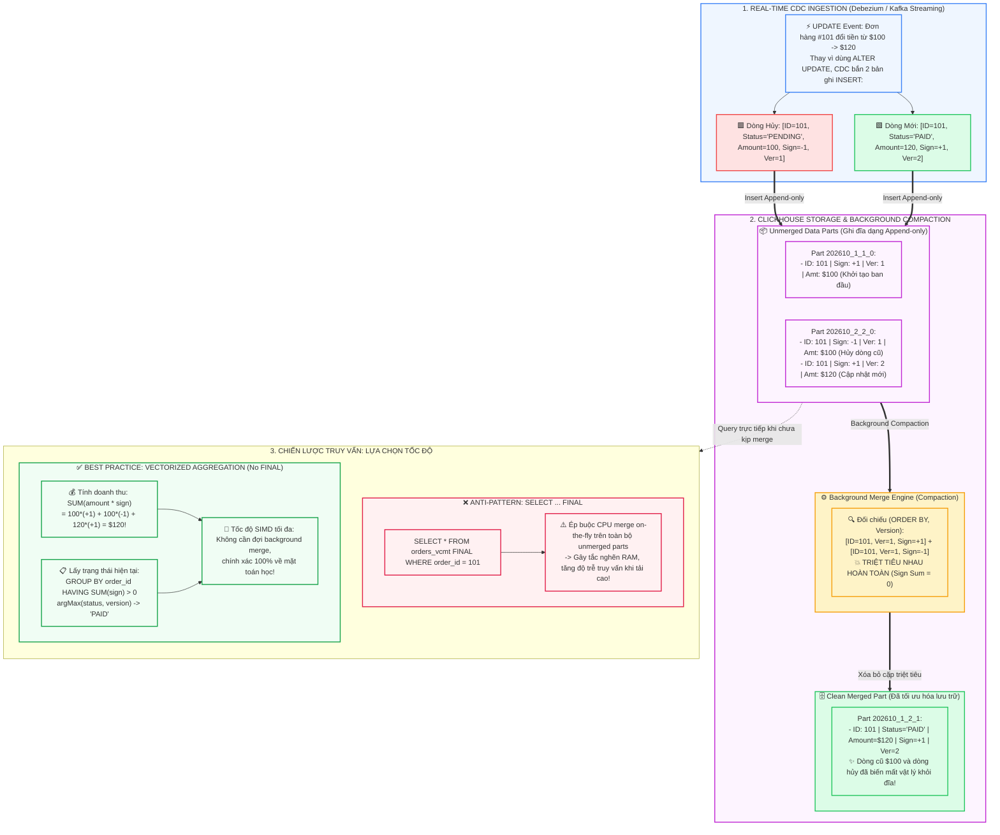

# CollapsingMergeTree & VersionedCollapsingMergeTree: Xóa và Cập nhật siêu tốc trong ClickHouse (Giải bài toán Update/Delete trạng thái theo thời gian thực)

"Bạn vừa thiết lập xong đường ống CDC (Change Data Capture) từ PostgreSQL sang ClickHouse qua Debezium và Kafka. 

Khi một đơn hàng đổi trạng thái từ PENDING sang PAID, theo thói quen của dân RDBMS, bạn để ứng dụng bắn ngay một câu lệnh:
`ALTER TABLE orders UPDATE status = 'PAID' WHERE order_id = 1001;`

Chỉ sau 10 phút chịu tải vài trăm sự kiện mỗi giây, máy chủ ClickHouse bắt đầu 'rên rỉ': Disk I/O chạm ngưỡng 100%, hàng nghìn mutation xếp hàng nghẽn cứng, CPU quá tải và hệ thống ném ra lỗi crash kinh điển:
`DB::Exception: Too many parts in all data parts in table`!

Chào mừng bạn đến với cú sốc kiến trúc lớn nhất khi chuyển từ OLTP sang OLAP: **Tại sao thao tác UPDATE / DELETE – vốn là chuyện 'cơm bữa' ở MySQL/PostgreSQL – lại trở thành 'bản án tử hình' đối với ClickHouse?**

Và làm thế nào ClickHouse giải quyết bài toán Cập nhật/Xóa hàng triệu bản ghi mỗi giây bằng cơ chế **CollapsingMergeTree & VersionedCollapsingMergeTree** mà không làm suy giảm 1% hiệu năng? Hãy cùng mổ xẻ tận gốc rễ!

---

### 1. Bản chất: Tại sao `ALTER UPDATE/DELETE` là "Tự sát" trong Real-time Ingestion?

Để hiểu tại sao ClickHouse lại 'dị ứng' với UPDATE/DELETE, ta phải nhìn vào cấu trúc vật lý của nó:

1. **Thế giới RDBMS (PostgreSQL/MySQL)**:
   - Dữ liệu được lưu trong các Data Page có thể ghi đè (Mutable). Khi bạn UPDATE 1 dòng, database tìm đến đúng Page đó trong Buffer Pool, sửa tại chỗ (In-place) hoặc tạo một tuple mới rồi ghi nhật ký WAL. Thao tác trên một vài dòng chỉ tốn vài mili-giây.

2. **Thế giới ClickHouse (Columnar OLAP)**:
   - Dữ liệu được lưu trữ trong các **Data Part hoàn toàn bất biến (Immutable Data Parts)**. Một khi đã ghi xuống đĩa, tệp part không bao giờ bị can thiệp sửa đổi từng byte.
   - Khi bạn chạy `ALTER TABLE ... UPDATE` hoặc `DELETE`, ClickHouse gọi đây là một **Mutation**.
   - Để sửa duy nhất 1 dòng, ClickHouse bắt buộc phải:
     - Quét tìm Data Part chứa dòng đó (có thể nặng từ vài trăm MB đến cả GB).
     - **Đọc toàn bộ part cũ lên, giải nén toàn bộ các cột liên quan**.
     - Tính toán lại giá trị mới và **ghi lại toàn bộ part mới xuống đĩa (Full Part Rewrite)**.
     - Xóa part cũ và thay thế bằng part mới.

👉 **Hãy làm một phép tính rùng mình**: Nếu hệ thống CDC của bạn có 500 đơn hàng cập nhật trạng thái mỗi giây, bạn sẽ kích hoạt 500 lần đọc-ghi lại toàn bộ các file data part khổng lồ mỗi giây! Đĩa cứng NVMe nhanh nhất thế giới cũng sẽ bốc khói, hàng đợi mutation tắc nghẽn và server sụp đổ hoàn toàn.

**Quy tắc vàng**: `ALTER TABLE UPDATE / DELETE` trong ClickHouse sinh ra để bảo trì định kỳ (Batch maintenance như xóa data tuân thủ luật GDPR mỗi tháng 1 lần), **TUYỆT ĐỐI KHÔNG DÙNG cho luồng streaming CDC real-time!**

---

### 2. CollapsingMergeTree: Cơ chế Triệt tiêu Hạt & Phản hạt (Sign Column)

ClickHouse giải quyết bài toán này bằng một triết lý thuần túy: **Biến mọi thao tác UPDATE và DELETE thành 100% Append-only INSERT.**

Đó là sự ra đời của **`CollapsingMergeTree`**.

Động cơ này yêu cầu bạn định nghĩa một cột đặc biệt có tên là **`sign`** với kiểu dữ liệu `Int8`:
- `sign = 1`: Đại diện cho **Trạng thái hoạt động (State row)**.
- `sign = -1`: Đại diện cho **Trạng thái hủy / Triệt tiêu (Cancel row)**.

```sql
CREATE TABLE orders_collapsing (
    order_id UInt64,
    user_id UInt32,
    status LowCardinality(String),
    amount Decimal64(2),
    updated_at DateTime,
    sign Int8
) ENGINE = CollapsingMergeTree(sign)
PRIMARY KEY order_id
ORDER BY (order_id, user_id);
```

#### Quy trình Xóa và Sửa diễn ra như thế nào?
- **Khi tạo đơn hàng mới ($100, PENDING)**:
  - Bắn 1 lệnh INSERT bình thường với `sign = 1`.
- **Khi cập nhật đơn hàng thành PAID ($120)**:
  - Thay vì chạy `UPDATE`, hệ thống CDC sẽ INSERT **đồng thời 2 dòng** trong 1 batch:
    1. Dòng cũ cần triệt tiêu: `[order_id=101, status='PENDING', amount=100, sign=-1]`
    2. Dòng mới thay thế: `[order_id=101, status='PAID', amount=120, sign=1]`
- **Khi xóa đơn hàng (DELETE)**:
  - Chỉ cần INSERT 1 dòng mang trạng thái cũ với `sign = -1`.

#### Phép màu trong Background Compaction (Merge)
Trong quá trình ClickHouse thực hiện background merge các data parts:
- Khi thuật toán merge duyệt qua các dòng có cùng khóa `ORDER BY`:
- Nếu gặp một cặp dòng gồm `sign = 1` và `sign = -1`, cơ chế Collapsing sẽ **tự động triệt tiêu lẫn nhau (Annihilation)**:
  $$(+1) + (-1) = 0 \Longrightarrow \text{Cả 2 dòng bị xóa sổ vật lý khỏi đĩa!}$$
- ClickHouse không cần ghi lại bảng, không tốn tài nguyên đột biến, không gian đĩa được giải phóng hoàn toàn tự động!

---

### 3. Tử huyệt của CollapsingMergeTree & Sự ra đời của VersionedCollapsingMergeTree

Mô hình trên nghe có vẻ hoàn hảo, nhưng trong các hệ thống phân tán thực tế, nó gặp phải một **"tử huyệt" chí mạng: Vấn đề Xáo trộn Thứ tự (Out-of-order Ingestion)**.

`CollapsingMergeTree` có một tiền đề nghiêm ngặt: Dòng `sign = 1` bắt buộc phải được ghi trước hoặc xuất hiện đúng thứ tự trước dòng `sign = -1`.

Nhưng thực tế đời sống Data Engineering không màu hồng như vậy:
- Kafka Topic có nhiều Partitions hoặc Consumer xử lý đa luồng (multi-threaded).
- Sự cố mạng khiến gói tin chứa dòng hủy (`sign = -1`) đến đích trước dòng khởi tạo (`sign = 1`).
- Khi dòng `-1` đến trước dòng `+1`, `CollapsingMergeTree` **sẽ KHÔNG THỂ TRIỆT TIÊU**! Cả hai dòng sẽ cùng tồn tại vĩnh viễn trong cơ sở dữ liệu, phá vỡ tính đúng đắn của dữ liệu.

#### Cứu tinh: VersionedCollapsingMergeTree
Để khắc chế triệt để bài toán Out-of-order, ClickHouse bổ sung thêm cột **`version`**:

```sql
CREATE TABLE orders_vcmt (
    order_id UInt64,
    user_id UInt32,
    status LowCardinality(String),
    amount Decimal64(2),
    updated_at DateTime,
    sign Int8,
    version UInt32
) ENGINE = VersionedCollapsingMergeTree(sign, version)
PRIMARY KEY order_id
ORDER BY (order_id, user_id);
```

**Bí mật kiến trúc**: ClickHouse tự động bổ sung cột `version` vào cuối khóa `ORDER BY` ngầm định.
Khi background merge diễn ra:
- ClickHouse tìm kiếm các cặp dòng có cùng `ORDER BY` và **cùng giá trị `version`**.
- Bất kể dòng `sign = -1` đến trước hay dòng `sign = 1` đến sau, miễn là chúng có chung `(ORDER BY, version)`, chúng sẽ **triệt tiêu lẫn nhau 100%**!
- Điều này biến ClickHouse thành một cỗ máy nuốt dữ liệu CDC bất khả chiến bại, chấp nhận mọi sự xáo trộn mạng phân tán.

---

### 4. Đừng biến Database thành "Rùa bò" với `SELECT ... FINAL`

Rất nhiều kỹ sư sau khi tạo bảng `VersionedCollapsingMergeTree` lại viết câu query như sau:
```sql
-- CẢNH BÁO: ANTI-PATTERN LÀM SẬP HIỆU NĂNG!
SELECT * FROM orders_vcmt FINAL WHERE user_id = 42;
```

**Tại sao phải tránh xa `FINAL`?**
Mặc dù `FINAL` sẽ ép ClickHouse trả về dữ liệu đã triệt tiêu chính xác nhất, nhưng nó làm điều đó bằng cách:
- Ép CPU gom toàn bộ các data parts chưa merge lại và thực hiện thuật toán collasping **ngay trong bộ nhớ RAM lúc truy vấn (On-the-fly merge)**.
- Triệt tiêu khả năng quét song song đa lõi tốc độ cao, tiêu tốn lượng RAM khổng lồ và khiến độ trễ (latency) tăng vọt gấp 10 - 50 lần khi dữ liệu lớn!

#### Tuyệt chiêu Vectorized Query không cần FINAL:

Thay vì bắt database phải merge vật lý, hãy tận dụng **sức mạnh đại số** kết hợp cùng khả năng tính toán Vectorized SIMD của ClickHouse:

#### 1. Tính toán Số liệu Tổng hợp (Doanh thu, Số dư, Thống kê): Dùng `SUM(amount * sign)`
```sql
SELECT 
    sum(amount * sign) AS real_revenue,
    countIf(sign = 1) - countIf(sign = -1) AS total_active_orders
FROM orders_vcmt;
```
- Nếu đơn hàng $100 bị hủy và cập nhật thành $120:
  $$\text{Doanh thu} = (100 \times 1) + (100 \times -1) + (120 \times 1) = \mathbf{120}$$
- Phép toán này chạy với tốc độ hàng trăm triệu dòng mỗi giây, chính xác tuyệt đối mà không cần bất kỳ một thao tác merge tốn kém nào!

#### 2. Lấy Trạng thái Mới nhất của Đơn hàng: Dùng `HAVING sum(sign) > 0` và `argMax()`
```sql
SELECT 
    order_id,
    argMax(status, version) AS current_status,
    argMax(amount, version) AS current_amount,
    argMax(updated_at, version) AS last_updated
FROM orders_vcmt
GROUP BY order_id
HAVING sum(sign) > 0;
```
- **Tại sao câu query này lại thông minh vượt trội?**
  - Nếu đơn hàng đã bị xóa (DELETE), tổng `sum(sign)` của nó sẽ bằng: $1 + (-1) = 0$.
  - Mệnh đề `HAVING sum(sign) > 0` sẽ **tự động gạt bỏ 100% các bản ghi đã bị xóa**!
  - Hàm `argMax(status, version)` sẽ lấy chính xác trạng thái tại phiên bản cao nhất.
  - Tận dụng tối đa bộ nhớ đệm, chạy song song đa luồng cực nhanh mà không bị nghẽn đĩa.

---

### 5. So sánh Tổng kết: Bộ ba Họ MergeTree xử lý Cập nhật

| Tiêu chí | ReplacingMergeTree | CollapsingMergeTree | VersionedCollapsingMergeTree |
| :--- | :--- | :--- | :--- |
| **Cột điều khiển** | `version` (tùy chọn) | `sign` (`Int8`: +1, -1) | `sign` (`Int8`) & `version` (`UInt*`) |
| **Thao tác UPDATE** | Ghi đè dòng version cao hơn | Ghi cặp: (-1) cũ + (+1) mới | Ghi cặp: (-1, v) + (+1, v+1) |
| **Thao tác DELETE** | Không tự nhiên (cần flag ảo) | Ghi dòng cũ (-1) | Ghi dòng hiện tại (-1, v) |
| **Out-of-order CDC** | Tốt (theo version) | ❌ Không hỗ trợ | ✅ Tuyệt đối chính xác |
| **Tốc độ Query** | Phụ thuộc `argMax` / `FINAL` | Siêu tốc với `SUM(x * sign)` | **Vô địch với `SUM(x * sign)` & `argMax`** |
| **Bài toán tối ưu** | Khử trùng lặp Logs, Dimension | CDC tuần tự 1 luồng | **Hệ thống Streaming quy mô lớn (Kafka CDC)** |

---

### 📊 Sơ đồ Kiến trúc: Cơ chế Triệt tiêu Sign (+1 / -1) & Khử Out-of-Order trong VersionedCollapsingMergeTree



---

Trong hệ thống dữ liệu thời gian thực của bạn, đội ngũ đang xử lý các tác vụ Update/Delete trạng thái tài khoản hoặc đơn hàng bằng phương pháp nào? Bạn đã từng gặp sự cố quá tải do lạm dụng `ALTER UPDATE` hay `SELECT FINAL` chưa? Hãy cùng chia sẻ kinh nghiệm thực chiến bên dưới! 👇

#DataEngineering #ClickHouse #CollapsingMergeTree #CDC #RealTimeAnalytics #DatabaseInternals #BigData
